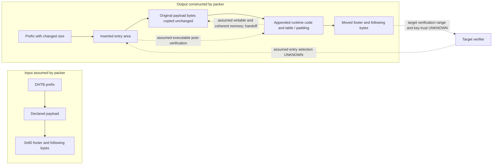

# P003 — magic64 architectural feasibility

**Result: unverified for Z2352N.** The upstream implementation provides a concrete post-verification modification model, not a device compatibility approval. No U-Boot, shellcode, patch table or flash artifact is generated here. The existing tools remain unchanged and are not run on target firmware. Finding IDs link to the [evidence register](P003_UBOOT_SECURITY_ARCHITECTURE.md#evidence-register), with claim class, source region, applicable build, confidence, uncertainty and required verification.

## What is observed and what is claimed

| Proposition | Evidence and class | Scope, confidence and outstanding verification |
|---|---|---|
| `pack()` copies the declared original payload unchanged, inserts an entry area and appended code, changes the DHTB size and footer fields, and trims only zero-valued discarded bytes. | **VERIFIED_SOURCE** [A2], [`pack`](../../tools/magic_pack_ums9620.py#L93) lines 93–141. | High for repository code; the output image is not wholly unchanged. Confirm actual signed region and verifier behavior with matching firmware and code before claiming signature preservation. |
| Author reports an Anbernic T820 booted using this packaging and that the `0xafe8`, `0xb2a4`, `0xb2ac` warning subset was tested, with an Anbernic text base `0xb5000000` and partition `0x300000`. | **VERIFIED_ANBERNIC** as an attributed author report [A3, A9]; [original note](https://github.com/TheGammaSqueeze/UnisocBypass/blob/1d046241ec2c0e96cf3c55c7e18e88e74acbe2da/docs/UMS9620_PORT.md#L54) lines 54–95. | Medium for the report; not independently rerun. Original binary, exact model/build/hash, experiment logs and detailed signature/fuse evidence are absent. Values and results are **ANBERNIC ONLY**. |
| `0x604c0` is an Anbernic-reported lock-status branch and the wrapper includes it, while the author's hardware-tested subset does not. The article explicitly says the device was already unlocked. | **INFERRED** [A4, A12], source table **VERIFIED_SOURCE** [A1]. [Original note](https://github.com/TheGammaSqueeze/UnisocBypass/blob/1d046241ec2c0e96cf3c55c7e18e88e74acbe2da/docs/UMS9620_PORT.md#L80) and [article](../MAGIC64_EXPLAINED.md#L182). | That offset, like `0xafe8`, `0xb2a4`, `0xb2ac`, is **ANBERNIC ONLY**, never a Z2352N target. The broader “unlock” claim is not proven by the reported warning subset. Need pre/post persistent state, verification-policy and Android image evidence, not merely a suppressed warning. |
| Original signed bytes remain acceptable to the loader despite changed header, footer and added executable bytes. | **HYPOTHESIS** for any untested build; author asserts it for Anbernic [A3], but the packer itself does not verify a signature [A2]. | The actual verification range, offset interpretation, signed metadata, DHTB hash policy, key chain, load range and entry source must all agree. No such Z2352N evidence exists [A13]. |
| A locked Z2352N can be unlocked by this method, accepts modified Android images, or obtains root. | **UNKNOWN** [A13]. | No target dump, policy, verifier trace or controlled outcome. Each is a separate later property; see [AVB evidence](P003_UBOOT_SECURITY_ARCHITECTURE.md#avb-outcomes-and-minimum-evidence). |

The author's direct observations should not be discarded, but neither their attribution nor matching SoC converts them into Z2352N evidence. The article's “does not unlock anything” and the wrapper's “force unlock” statement describe different intended uses or claims; the supplied record does not establish which behavior a previously locked device actually exhibits [A12]. Warning suppression, reporting unlocked, changed effective verification policy and acceptance of modified Android images are four different observations.

## Packaging and handoff assumptions

* **Stored image** — **VERIFIED_SOURCE** [A2]: the packer assumes a `0x200` prefix and 32-bit size at `0x30`; footer immediately follows the declared payload. It copies the original payload after a new 16-byte entry area, increases declared size by `0x100`, relocates the `0x60` footer, conditionally shifts four paired offsets, and carries remaining bytes forward. It retains the original DHTB hash field. The following bytes are called certificate/private/debug data by comments, but their semantics and bounds are not verified. The `0x210` payload-offset marker is a tool assumption, not a universal already-packed detector. Actual signed coverage remains **UNKNOWN** [A6, A13].
* **Verifier** — **INFERRED** [A2, A3]: successful post-verification modification requires the loader to authenticate the intended original bytes using altered metadata while not rejecting the inserted entry, appended code or modified metadata. It also requires the hash, certificate and offset checks to be compatible with those changes. Neither preserving a sequence of bytes nor a successful SHA comparison establishes these conditions. A verifier binding the entry, offsets, full image, length, or loaded memory to the signature could reject this design. Determine coverage and policy from the exact SPL and trust chain.
* **Entry** — **INFERRED** [A2]: the design requires the loader's actual control-transfer address to reach the newly inserted entry area after verification, rather than independently use the authenticated payload offset or a protected entry point. The article describes this intent; the actual Nubia handoff is **UNKNOWN**. Trace load and entry selection separately.
* **Runtime layout** — **VERIFIED_SOURCE / INFERRED** [A2]: the fixed AArch64 template is intended to restore the copied payload to its expected location, apply table entries, perform cache-related operations and return to the original entry. Its table uses absolute addresses derived from a supplied load base and offsets, stored as 32-bit values. This depends on actual physical/virtual mapping, relocation, exception level, memory permissions, cache maintenance and code/data coherence; none is known for Z2352N. An apparently valid branch or stock word cannot validate those assumptions. Examine the exact target and, if ever authorized, use independently observed runtime evidence.
* **Bounds and alignment** — **VERIFIED_SOURCE / INFERRED** [A2]: the table is limited to `0x80` bytes; copy count is `size // 8`; encoded branch values are masked rather than range-checked. Input length is assumed to be the full partition length; only the bytes discarded beyond that length are tested for nonzero content. Alignment, branch range, footer-pair bounds, actual partition capacity, full preservation of nonzero data, safe RAM overlap and absolute-address representability need independent checks. Zero bytes at the end of a file alone do not prove they are expendable on the device. Such checks would be later-phase work, not P003 image production.
* **Runtime integrity** — **ARCHITECTURAL** [A11]: authentication at load time does not automatically protect executable RAM afterwards. Later secure-world verification, write/execute permissions, measured boot, memory protection or cache behavior could prevent or detect the intended flow, or make it malfunction. Exact target protections are **UNKNOWN**.

## Compatibility gates and failure modes

All gates remain **UNKNOWN / not satisfied** on Z2352N [A13]; satisfying them would not authorize image mutation or hardware use.

| Gate | Evidence needed | Failure if assumed incorrectly |
|---|---|---|
| Artifact identity | Build-linked, byte-exact stock U-Boot, matching SPL and source provenance, hashes, slot and partition map. | Different build or slot can invalidate every layout and semantic inference. |
| Image format and coverage | Exact size width, footer variant, payload/cert boundaries, padding, cryptographic coverage and independent trust-anchor analysis. | Loader may reject altered metadata, hash, length or certificate, or parse an unintended region. |
| SPL policy | Actual authenticated loading, trust anchors, secure-boot state and failure behavior from target evidence. | Wrong signature/fuse assumption leads to unbootable image or invalid feasibility claim. |
| Handoff and memory | Entry selection, verified range vs loaded range, load/relocation addresses, permissions, available space and cache coherency. | Added bytes may never run, overwrite memory, fault or execute stale instructions. |
| Security semantics | Full build-specific callers, persistence, effective lock state, AVB callbacks, rollback and secure-service policies. | Cosmetic changes or one status path may leave enforcement intact or state inconsistent. |
| Space and partition | Exact partition/slot size and all nonzero trailing structures, offset and alignment constraints. | Data loss, invalid offsets or overflow; input length is not proof of partition capacity. |
| Recovery and validation | Independently evidenced backup, restore and appropriate recovery artifacts, plus a separately approved hardware plan. | Failure could prevent normal boot without a known restore path. P002 has not qualified FDLs. |

P004 readiness is **BLOCKED for target-specific binary research** until a provenance-matched image and its context exist. General offline source study and preparation of evidence criteria can continue without assuming offsets. P003 creates no approval for later firmware writes or hardware experiments.
