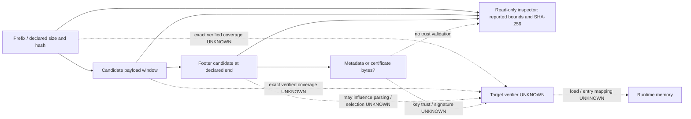

# P003 — Trust boundaries and image formats

This is a model of candidate boundaries, not a device boot trace. Finding IDs refer to the [evidence register](P003_UBOOT_SECURITY_ARCHITECTURE.md#evidence-register), which records class, source region, applicability, confidence, uncertainty and required verification. The general references in A11 are architecture references; the target verifier has not been inspected. All Z2352N boundary implementations and anchors below are **UNKNOWN** [A13].

## Boundary ledger

“Trusted stage” identifies a *candidate verifier*, not a proven trust decision. Authentication and failures shown with `?` are possibilities to investigate. Every row requires independent target verification; a later controlled hardware experiment requires its own authorization.

| Boundary / trusted stage | Input and possible authentication | Possible trust anchor | Possible failure / recovery | Evidence and Nubia status |
|---|---|---|---|---|
| Reset → BootROM | Boot source, mode straps/configuration; immutable ROM begins execution. The ROM may consult a secure-boot configuration. | Mask ROM and provisioned device state are architectural candidates. | Wrong source, unreadable media or mode selection may halt or select a download path; exact behavior unknown. | **ARCHITECTURAL** [A11]; Nubia ROM behavior and efuses **UNKNOWN** [A13]. |
| BootROM → SPL | First-stage bytes, headers and metadata; digest and/or signature enforcement may be conditional on provisioned state. | Device root key/hash, ROM policy or other target-specific anchor, all unestablished. | Reject, halt, alternate source or download mode are possible, not demonstrated on Nubia. | Anbernic rejection attributed in **VERIFIED_ANBERNIC** [A3]; RSA/fuse explanation is an author claim. UMS512 report [A5] is not T820 evidence. Nubia **UNKNOWN**. |
| SPL → trusted firmware | Secure-monitor/TEE or equivalent images, headers, certs; authentication scheme and order unknown. | SPL-trusted key/hash or earlier authenticated delegation, if present. | Verification failure, boot halt or recovery; target behavior unknown. | **ARCHITECTURAL** [A11]; UMS512 description [A5] is non-target. Nubia **UNKNOWN** [A13]. |
| SPL / trusted firmware → U-Boot | Stored U-Boot and associated metadata; author claims the Anbernic SPL verifies RSA. Exact verified bytes, load destination and entry selection unknown for Nubia. | Candidate signed-image public key chain; key authorization and root unknown. | Rejection, halt or fallback possible. | **VERIFIED_ANBERNIC** rejection as reported [A3]; proposed authentication mechanism remains independently unverified. Nubia **UNKNOWN**. |
| Trusted firmware ↔ U-Boot security service | State, verification requests and perhaps boot parameters; channel/protection/identity unknown. | An authenticated trusted-firmware stage and protected state, if present. | Service errors, inconsistent state, failure or fallback behavior unknown. | **ARCHITECTURAL** [A11], UMS512-only **INFERRED** service claim [A5]; Nubia **UNKNOWN**. |
| Persistent state → U-Boot / trusted firmware | Stored lock flag and validation material; integrity/authenticity, anti-replay, and error handling unknown. | Protected storage, device key or authenticated state are hypotheses only. | Missing, corrupted, replayed or conflicting state may be rejected, defaulted or mishandled; actual mapping unknown. | Anbernic source map **INFERRED** [A4]; Nubia **UNKNOWN** [A13]. |
| U-Boot / trusted verifier → Android images | VBMeta, descriptors, boot-related partitions, key and rollback state; actual provider and per-image verification unknown. | Provisioned AVB key(s), delegated keys and protected rollback indexes are architectural candidates. | Halt, recovery, slot fallback, or policy-dependent continuation possible. | Host metadata **VERIFIED_SOURCE** [A10], generic **ARCHITECTURAL** [A11]; target configuration **UNKNOWN**. |
| BootROM download → FDL1 → FDL2 → storage | Downloaded loader bytes, board initialization and later storage commands; authentication and authorization at each step unknown. | BootROM or download-stage keys/policy, if any. | Transport timeout, authentication rejection, initialization failure or storage denial are distinct. No response proves all steps. | P002 inventory **VERIFIED_SOURCE** [A8], [FDL notes](../FDL_QUALIFICATION.md#L8); target compatibility and UFS permissions **UNKNOWN**. |

## Stored-image data flow

### What the inspected tools actually establish

| Finding | Evidence and scope | Uncertainty / required verification |
|---|---|---|
| `DHTB`, version, stored hash, metadata and size | **VERIFIED_SOURCE** [A6, A7]: both parsers use a `0x200` prefix, hash bytes `0x08..0x27`, and size at `0x30`; P001 and the packer read **32-bit little-endian**, legacy parser and [DHTB_FORMAT](../DHTB_FORMAT.md#L10) read **64-bit little-endian**. | Upper four bytes may be meaningful or another field. A zero upper word can mask the disagreement. Determine width and semantics using the matching target loader, bounds and multiple real images; neither interpretation is universally T820. |
| Payload / hash span | **VERIFIED_SOURCE** [A6, A7]: tools calculate SHA-256 of `data[0x200:0x200+size]`; P001 checks bounds first. | This is a calculated candidate digest, not proof of the verifier's algorithm, covered range or authenticity. The upstream T820 SPL report says its stored hash was not the contiguous payload hash ([upstream note lines 13–20](https://github.com/TheGammaSqueeze/UnisocBypass/blob/1d046241ec2c0e96cf3c55c7e18e88e74acbe2da/docs/UMS9620_PORT.md#L13)); investigate by image and stage, not by changing the assumed span. The legacy parser hashes a potentially truncated slice without a separate payload bounds rejection. |
| Classic SIMGHDR | **VERIFIED_SOURCE** [A6, A7]: legacy parser expects `SIMGHDR\0` and `0x494` bytes, reads fields, exponent, modulus, hash copies and signature-like bytes; P001 tests structural size, exponent and hash-copy agreement. [SIMGHDR_FORMAT](../SIMGHDR_FORMAT.md#L1) is an older UMS512/Vita interpretation. | P001's accepted classic fields do not prove a valid signature, key trust, correct modulus encoding or target format. Legacy note's 252-byte modulus description conflicts with parser's `0x6c:0x16c` 256-byte slice; exact field semantics need original format/verifier evidence. The second hash purpose remains unknown. |
| Vendor-style footer | **VERIFIED_SOURCE** [A2, A6]: packer reads `0x60` bytes at `0x200 + size`, checks first seven marker bytes, interprets a 64-bit field at `+0x18` as input payload offset `0x200`, adjusts it to `0x210`, and adjusts next fields in four pairs conditional on their first field. | Code labels trailing bytes certificate/private/debug data but does not parse, validate bounds or establish RSA coverage or trust. P001 reports pairs and accepts `0x200`/`0x210`, but does not validate all vendor-pair ranges or certificate meaning. The real target footer may be different. |
| Padding, alignment and boundary | **VERIFIED_SOURCE** [A2, A6]: packer adds `0x100`, checks any discarded bytes are zero, and truncates to **input file length**, which it assumes represents the partition; inspector checks declared payload/footer bounds and supplied partition size. | Inspector does not prove the entire trailing region is zero padding or that input length is a partition size. Zero padding cannot by itself identify a footer. The packer's copy loop uses `size // 8` and branch encoding masks; the function has no explicit check of payload alignment or branch range. Verify all actual lengths, alignment, field ranges and partition bounds rather than presuming them. |
| Footer selection / ambiguity | **VERIFIED_SOURCE** [A6]: P001 tests classic candidate fields before requiring full `0x494` bytes; malformed classic candidates fail closed, padded vendor/classic synthetic fixtures are covered. Otherwise it interprets a marker plus supported payload offset as vendor. | This is a heuristic at a single declared payload end, not an exhaustive search or a proof that a vendor-looking candidate is unique. An unsupported/ambiguous layout can resemble either profile. Preserve raw bytes and independently reconcile candidate boundaries and metadata against the target verifier; do not treat a label as cryptographic proof. |

### Five independent properties

1. **Structure identified:** markers, fields and bounds fit a parser's model [A6, A7]. A match does not establish meaning or unique layout.
2. **Hash calculated:** the tool computes a digest over its stated byte range and compares it with a stored value [A6, A7]. A match is integrity under that interpretation, not authenticity or evidence of the target's hash policy.
3. **Signature verified:** requires the actual signature algorithm, precisely defined message bytes, public key, validated trust anchor/chain and a successful independent cryptographic verification. Neither inspected parser performs this [A6, A7]. A modulus, exponent, certificate, nonzero signature or hash match is insufficient. P001's `signature_verified: false` means **not performed/unknown**, not an invalid signature.
4. **Accepted by SPL:** depends on the real SPL, fuse policy, anchor, metadata, bounds, version and failure handling. An offline signature result alone cannot prove acceptance [A11, A13].
5. **Executed successfully:** additionally requires valid load/entry mapping, executable memory and a successful handoff. Acceptance alone cannot prove runtime behavior [A2, A11, A13].

## Contradictions that remain open

* **Size and footer:** legacy `dhtb_parse.py` / UMS512 format notes describe a 64-bit size and a `0x494` classic block; the UMS9620 packer uses a 32-bit size and a `0x60` footer plus following data [A2, A7]. P001 recognizes two patterns, not a universal format [A6]. Do not merge field meanings across layouts.
* **DHTB hash:** the generic note says UMS512 BootROM checks SHA-256 of the payload, while the Anbernic T820 SPL report says its stored hash is not that contiguous SHA-256. The packer changes `mImgSize` and prepends/appends bytes without updating the hash [A2, A3, A5]. Its output may therefore fail P001's generic contiguous-hash comparison; this neither proves nor disproves what a particular SPL checks.
* **Entry and signature:** the article says the original signed U-Boot is unchanged but also describes redirecting the first instruction. The actual packer *inserts* a 16-byte entry area ahead of the copied payload, moves the footer, changes metadata and appends code [A2]. It preserves a payload byte sequence, not the entire image. Whether those changed bytes and metadata are protected and which entry the verifier executes must be established from the real target verifier.
* **RSA wording:** the legacy parser prints “formally signed” for nonzero signature-like bytes and identifies keys by a short modulus prefix [A7]. It does not verify RSA or prove key identity or authorization. Treat those labels as structural hints only.
* **Verification policy:** UMS512 documentation variously says “skipped,” “tolerant,” and that DTBO can still hard-fail; see [AVB outcomes](P003_UBOOT_SECURITY_ARCHITECTURE.md#avb-outcomes-and-minimum-evidence). These claims are not interchangeable and do not resolve target behavior [A5, A13].

## Failure and recovery evidence

Header parse failure, hash mismatch, invalid signature, untrusted key, rollback rejection, failed memory handoff, Android failure and transport timeout are different events [A6, A8, A11]. A failure log needs its stage, image hash, build, slot and context; a timeout alone identifies neither the active stage nor an authentication rejection. No recovery mechanism, backup ability or restore route is proven for Z2352N [A13]. P002's offline log classifier records phrases without asserting root cause. The [evidence matrix](P003_EVIDENCE_MATRIX.md) specifies read-only evidence and hardware gates.
