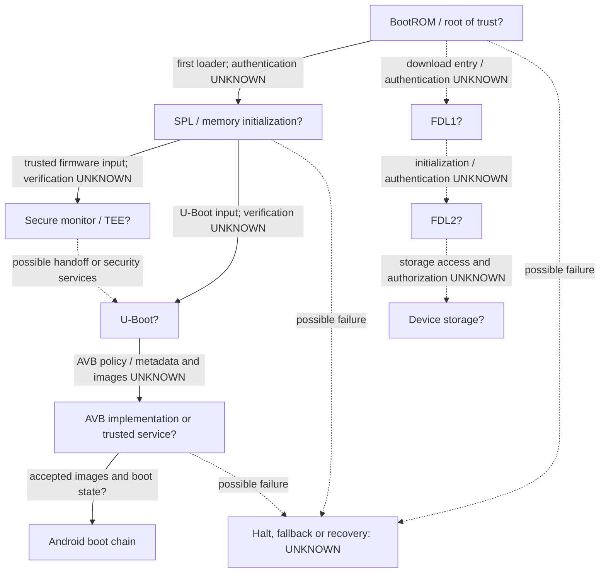
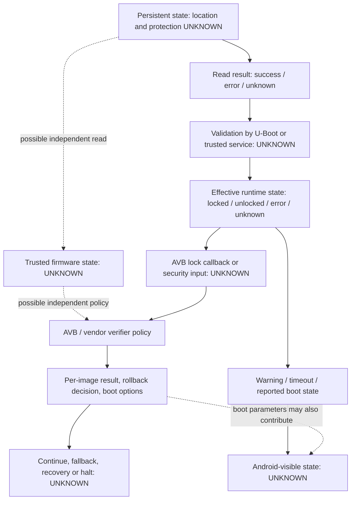

# P003 — Z2352N U-Boot security architecture

**Decision:** the available material supports an architecture for investigation, not a verified Z2352N boot chain or unlock. The requested identity (nubia Neo 2 5G, Z2352N, P820F03, T820/UMS9620, AArch64) is the **research target supplied by the requester**, not an independently verified device record. No actual Z2352N firmware, boot log, or hardware was inspected. Root is the eventual project requirement; neither unlock, root, nor an image transformation is performed here.

Companion reports: [trust boundaries](P003_TRUST_BOUNDARIES.md), [magic64 feasibility](P003_MAGIC64_FEASIBILITY.md), [evidence matrix and phase gates](P003_EVIDENCE_MATRIX.md). Bracketed finding IDs refer to the evidence register below; each has scope, confidence, uncertainty and the verification needed. Confidence is in the stated claim, not in its applicability to Nubia. A source-code observation about a host tool does not verify the behavior of the device.

## Evidence rules and provenance

Classes: **VERIFIED_SOURCE** = directly inspected code; **VERIFIED_ANBERNIC** = an attributable upstream author-reported Anbernic hardware observation, not independently rerun in P003; **ARCHITECTURAL** = general architecture, not a target finding; **INFERRED** = source-derived interpretation; **HYPOTHESIS** = plausible unverified mechanism; **UNKNOWN** = insufficient evidence; **VERIFIED_Z2352N** = independent actual-device evidence. No finding here qualifies as VERIFIED_Z2352N. An author statement about a mechanism is not promoted to a source-code or cryptographic proof. Evidence priority is directly inspected code, reproducible binary observations, documented hardware experiments, author documentation, general references, then hypotheses. The register distinguishes a code fact from the behavior the author attributes to it.

Sources were inspected at fork base `84ac314f78c5fed6f20aa7adda03cb0fee938c4f`. The upstream `main` HEAD was `1d046241ec2c0e96cf3c55c7e18e88e74acbe2da`; the fork's [P001 port note](../UMS9620_PORT.md) replaced the earlier [upstream port note, fixed at that commit](https://github.com/TheGammaSqueeze/UnisocBypass/blob/1d046241ec2c0e96cf3c55c7e18e88e74acbe2da/docs/UMS9620_PORT.md). The other eight requested upstream documents/tools are unchanged from that upstream commit at this base. P002's [FDL qualification](../FDL_QUALIFICATION.md), both offline tools, existing tests and [CI](../../.github/workflows/research-validation.yml) were inspected. Original experiment logs, binary hashes, target verifier source and real firmware were not provided. A citation to an upstream experiment is attribution, not independent reproduction.

### Evidence register

| ID | Claim; class | Source and region | Applies to; confidence | Uncertainties and required verification |
|---|---|---|---|---|
| A1 | The wrapper holds four instruction masks and delegates to a packer; it checks words against the declared payload, not device identity or semantic equivalence. **VERIFIED_SOURCE** | [patcher `PATCHES`, `verify`](../../tools/patch_uboot_unlock_ums9620.py#L56) lines 56–92, 140–146 | Repository tool; high | Target functions and branches are unknown; inspect build-specific surrounding control flow and callers. |
| A2 | Packer copies the original payload bytes, inserts additional content, changes size/footer fields and truncates only if discarded bytes are zero. **VERIFIED_SOURCE** | [`pack`](../../tools/magic_pack_ums9620.py#L93) lines 93–141 | Repository tool; high | Byte preservation does not establish signed coverage, verifier acceptance, or runtime execution; inspect matching verifier and independently verify. |
| A3 | Anbernic T820 author reports rejection of modified SPL/U-Boot and successful magic packaging with warning/timeout changes; three warning sites were hardware-tested. **VERIFIED_ANBERNIC** | [Upstream port note](https://github.com/TheGammaSqueeze/UnisocBypass/blob/1d046241ec2c0e96cf3c55c7e18e88e74acbe2da/docs/UMS9620_PORT.md#L13) lines 13–20, 54–70, 80–95; [article](../MAGIC64_EXPLAINED.md#L33) | Author's Anbernic T820 build; medium for attributed report | Logs, build hash, fuse readout and independently reproduced signature checks absent. Obtain original evidence and distinguish rejection observation from asserted RSA/efuse mechanism. Not Z2352N evidence. |
| A4 | The author reports `get_lock_status` reads `productinfo` with `common_raw_read`, calls `sprd_sec_verify_lockstatus`, then stores a lock global; it identifies an AVB callback and warning callers. **INFERRED** (author reverse-engineering, not independently inspected target code) | [Upstream port note](https://github.com/TheGammaSqueeze/UnisocBypass/blob/1d046241ec2c0e96cf3c55c7e18e88e74acbe2da/docs/UMS9620_PORT.md#L100) lines 100–127 | Examined Anbernic U-Boot build; medium for what is reported, low for semantics | No binary, full callers or callee implementations here; reproduce symbol/call/return analysis on a provenance-matched image. Not a Nubia map. |
| A5 | UMS512 documents claim BootROM/SPL verification details and a TrustOS AVB handoff. **INFERRED** as a report of author analysis, not direct source verification | [CHAIN_OF_TRUST](../CHAIN_OF_TRUST.md#L5) lines 5–50; [UBOOT_UNLOCK](../UBOOT_UNLOCK.md#L87) lines 87–127; [ANALYSIS](../ANALYSIS.md#L1) | Anbernic RG Vita UMS512/T618; medium for attribution | Those files do not establish T820 behavior; target-specific SPL, trusted firmware and boot evidence are needed. |
| A6 | The inspector reads a little-endian 32-bit size, computes a contiguous SHA-256, uses structural footer heuristics, and never verifies RSA. **VERIFIED_SOURCE** | [`inspect_bytes`, `_parse_footer`](../../tools/inspect_uboot_ums9620.py#L79) lines 79–146, 150–198, 231–274 | P001 host tool, accepted inputs; high | Heuristic formats, hash span and field width are not target validation; compare actual image and verifier. `signature_verified: false` means verification was not performed, not cryptographic failure. |
| A7 | Legacy parser reads a 64-bit size, a fixed classic block, compares hashes and only checks whether signature bytes are nonzero. **VERIFIED_SOURCE** | [`parse_dhtb_header`, `parse_simghdr`, `dump_image`](../../tools/dhtb_parse.py#L21) lines 21–66, 96–152 | Legacy parser; high | No bound check before its hash slice and no RSA verification; confirm actual format independently. |
| A8 | FDL inventory classifies metadata and files as structurally incompatible, insufficient evidence, or unverified; none means compatible. **VERIFIED_SOURCE** | [`analyze`, `classify_log`](../../tools/fdl_qualify.py#L158) lines 158–325, 329–346 | P002/P002A host tool; high | No FDL execution or UFS access established; need authorized future evidence. |
| A9 | The upstream note attributes a text base `0xb5000000`, partition length `0x300000`, and warning-subset behavior to its Anbernic test. **VERIFIED_ANBERNIC** | [Upstream port note](https://github.com/TheGammaSqueeze/UnisocBypass/blob/1d046241ec2c0e96cf3c55c7e18e88e74acbe2da/docs/UMS9620_PORT.md#L62) lines 62–70, 95 | That Anbernic image only; medium as attributed observation | No independent runtime trace or artifact included. Never use these values as Nubia defaults or targets. |
| A10 | AVB metadata can carry partition descriptors, public-key information and rollback-index locations. **VERIFIED_SOURCE** | Vendored [`AvbChainPartitionDescriptor`](../../tools/avbtool#L1799) lines 1799–1852 and [`AvbVBMetaHeader`](../../tools/avbtool#L2050) lines 2050–2068 | Host avbtool metadata representation; high | Does not establish target descriptors, trusted keys, libavb integration or enforcement. Inspect matching target metadata and code. |
| A11 | A boot chain can use a hardware root of trust to authenticate successive stages; verified boot can consume key trust, lock status and rollback policy, then communicate a boot state. **ARCHITECTURAL** | [Android AVB overview](https://source.android.com/docs/security/features/verifiedboot/avb) and [boot flow](https://source.android.com/docs/security/features/verifiedboot/boot-flow); [ARM Trusted Board Boot](https://trustedfirmware-a.readthedocs.io/en/latest/design/trusted-board-boot.html) (general references; target implementation not inspected) | Generic Android/ARM design; medium | Ordering, verifier, storage and failure policy are implementation-specific; inspect target stages and configuration. |
| A12 | The upstream port note identifies a lock-status branch as forcing UNLOCK, but its listed hardware-tested subset excludes that branch. **INFERRED** | [Upstream note](https://github.com/TheGammaSqueeze/UnisocBypass/blob/1d046241ec2c0e96cf3c55c7e18e88e74acbe2da/docs/UMS9620_PORT.md#L80) lines 80–108; [article](../MAGIC64_EXPLAINED.md#L182) | Anbernic build; medium for discrepancy | Whether a locked device transitioned, AVB enforcement changed or modified Android booted is not demonstrated by cited subset; obtain independent before/after evidence. |
| A13 | Exact target fuse state, keys, stages, layouts, functions, lock state and AVB behavior are not established by the available material. **UNKNOWN** | [P001 target limitations](../UMS9620_PORT.md#L1); [P002 limits](../FDL_QUALIFICATION.md#L1); no target artifact | Z2352N; high confidence that evidence is missing | Supply provenance-linked, legally obtained matching device/build artifacts and future separately authorized observations; see matrix. |

## Expected chain and boundaries

The following is a **conceptual model**, not a confirmed ordering for this model [A11, A13]. BootROM is the immutable entry and may select a source and authenticate the first loader against a provisioned anchor or fuse policy. Whether secure boot is enabled and what is checked are **UNKNOWN** on Z2352N. SPL may initialize memory, load/authenticate trusted firmware and U-Boot, and hand control via trusted stages; these relationships are also **UNKNOWN** on Z2352N. Trust anchors might be fused key hashes, embedded keys, certificates or a chain of them; a certificate in an image alone proves none of these. Lock state may be passed to or independently read by later verifiers; the route and integrity protection are **UNKNOWN**. Boundaries, inputs, possible checks and failure paths are enumerated in [trust boundaries](P003_TRUST_BOUNDARIES.md#boundary-ledger).

The FDL path is separate from normal boot, not proof of access to or authorization for UFS. P002 documents a generic two-stage download sequence, board-specific initialization risks and a conservative offline inventory [A8]; no Z2352N FDL is hardware qualified. An FDL response or a timeout does not identify signature policy or demonstrate storage access. Neither UMS512's described BootROM checks nor its SPL's claimed RSA scheme should be transferred to T820 [A5, A13].

## Function and responsibility inventory

These names are **reported Anbernic roles**, not verified Z2352N symbols [A4, A13]. `0x604c0`, `0xafe8`, `0xb2a4`, `0xb2ac` and base `0xb5000000` are **ANBERNIC ONLY**; none is a Z2352N patch target. Inputs/outputs below are as reported or explicitly identified as unknown; generic roles are architectural and do not assert symbol presence.

| Role and evidence | Inputs → outputs; callers / side effects | State dependency, trust implication and required verification |
|---|---|---|
| `get_lock_status` [A4, A12] | Reported read of `productinfo` buffer then verification result → stored runtime `g_DeviceStatus` and return; reported warning routine calls it. Other callers unknown. | Persisted bytes and verifier result can affect effective state; caller behavior, failure mapping and any secure-world corroboration unknown. Trace complete callers and error paths in exact target. |
| `common_raw_read` [A4] | Reported partition name, length, offset and destination → data/status; called by reported getter. Raw read side effect is a buffer update; actual errors and authentication unknown. | Reading bytes does not authenticate them. Establish location, bounds, storage security and return handling from target code. |
| `sprd_sec_verify_lockstatus` [A4] | Reported buffer and length → status; reported caller is getter. Its cryptographic mechanism, output encoding, trusted-world access and side effects are unknown. | Name alone does not prove a signature or protected storage. Trace callee and service boundary on matching build. |
| `read_is_device_unlocked` [A4, A11] | Author reports an `AvbOps` callback slot, called from `avb_append_options`; input context and returned bool/error semantics in this build need verification. | A callback can report a value while other verifiers consult another source. Inspect vtable initialization, caller, outputs and error handling. |
| Other AVB operations [A10, A11] | Conceptually partition reads, key validation, rollback-index reads/writes and lock state feed verification; results and boot options flow outward. Exact target names/callers unknown. | A descriptor or callback does not establish policy. Identify target implementation, all key/rollback and IO callbacks, secure-service crossings and error propagation. |
| Lock-state persistence / initialization [A4, A13] | Anbernic report identifies a read source and runtime global; writers, initialization, factory reset behavior and errors are not shown. | Distinguish persistent authenticated state from cached or inferred runtime state. Trace all writers and boot-time initialization for the target. |
| Boot-state reporting [A5, A11] | U-Boot/secure service may produce boot parameters and UI status; callers and exact channels on Nubia unknown. | Output is a report, not proof of persistent state or actual policy. Correlate independent sources and verification outcomes. |
| Android image verification / failure [A5, A10, A11] | AVB metadata and partition bytes, key trust and rollback state may yield per-image success, error or policy-dependent tolerance; actual callers unknown. | Trace each descriptor, image, verifier and failure/fallback path; verify target partition and slot layout. |
| Warning / timeout [A3, A4, A9] | Reported Anbernic warning code consumes lock global; a warning routine emits messages and waits. Its exact failure and side effects are build-specific. | Removing text/delay establishes presentation only. Compare stored state, verifier decisions and boot outcomes separately. |

## Lock-state and AVB control flow

These are possible stages, not a confirmed Z2352N state machine. An **effective runtime** value may differ from the persistent flag, its validation result, the secure-world view, an AVB callback, or user-facing strings [A4, A11, A13]. Model `locked`, `unlocked`, `error` and `unknown` explicitly: an error or absent evidence is not equivalent to unlocked or locked. The mapping of read/verification errors and fallback to a safe state is **UNKNOWN** on this target.

A changed status-returning function could influence one consumer while a secure monitor, TrustOS, rollback check, partition-specific verifier or another caller enforces a different policy. Conversely, altered text or an `orange`-style report is not a proof that storage changed or modified images will be accepted [A11, A12, A13]. UMS512 material itself differs: [CHAIN_OF_TRUST](../CHAIN_OF_TRUST.md#L47) says AVB is skipped, [UBOOT_UNLOCK](../UBOOT_UNLOCK.md#L87) says verification still runs in a tolerant mode, and [AVB_RESIGN](../AVB_RESIGN.md#L6) reports DTBO can still hard-fail. These are author claims about a different build and must not be reconciled by assuming a target policy [A5].

## AVB outcomes and minimum evidence

General AVB may authenticate VBMeta and descriptors against a trusted key, follow chained metadata, check hashes/hashtrees and rollback indexes, and pass boot options to Android [A10, A11]. Whether Z2352N uses libavb in U-Boot, a trusted service, both, or vendor alternatives, and which of `boot`, `init_boot`, `vendor_boot`, `dtbo` or other partitions are present and covered, are **UNKNOWN** [A13]. A failure may halt, fall back to another slot, recover or be tolerated depending on the exact policy; do not assume a fallback or that unlocked relaxes every check.

| Separately demonstrated property | Minimum Z2352N evidence; present status |
|---|---|
| Bootloader reports unlocked | Model/build-linked, timestamped bootloader and Android-reported state, with source and slot context; **UNKNOWN**. A report alone does not prove persistence or enforcement. |
| AVB verification is relaxed | Exact verifier/callback path and controlled, separately authorized evidence of policy decisions and rollback behavior on the matching build; **UNKNOWN**. |
| Modified `boot`/`init_boot` accepted | Confirm actual partition, slot and descriptor coverage, then controlled separately authorized per-image boot/verifier observations and reproducible before/after hashes; **UNKNOWN**. Not implied by state or by another partition. |
| Android boots | Matching build reaches stable Android after the relevant image change, with boot logs and verified active slot; **UNKNOWN**. Bootloader handoff alone is insufficient. |
| Magisk obtains UID 0 | Later separately authorized, reproducible Magisk installation and explicit UID 0 process result on the intended stock MyOS build, plus boot stability; **UNKNOWN**. Android boot alone is insufficient. |

No such hardware or image changes are authorized in P003. The following phases must have their own scope and approval.
